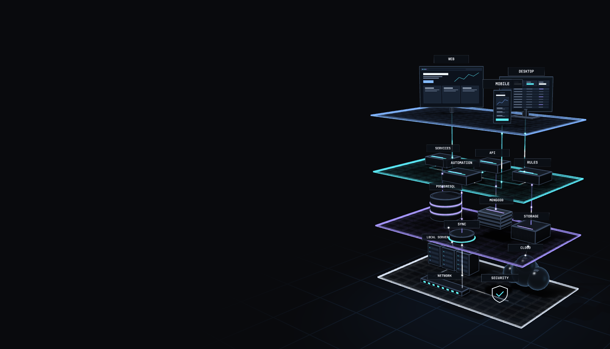
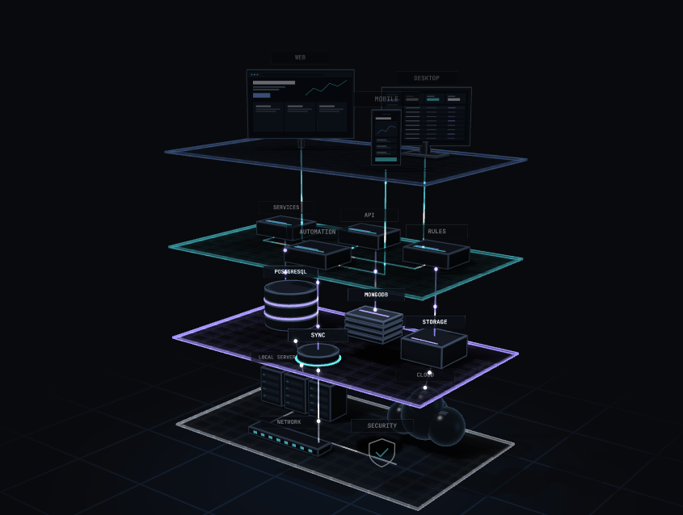
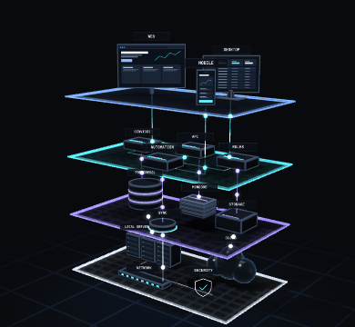
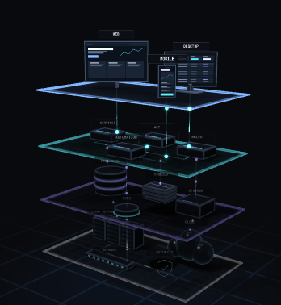

# T3 — Fidelidad del port del motor 3D (ronda R1)

**Fecha:** 2026-11-13. **Rama:** `claude/admiring-babbage-bjvbo8`, sobre `984b712`.
**Estado:** medición terminada. **Informe aprobado por Julio (2026-11-13)**, que
autorizó la ronda R2. P-28 se resolvió después (opción A completa): los puntos 1
y 2 de §8 quedan cerrados (un rótulo oculto del atlas va sin recuadro).
Nada de este informe se da por aprobado. La tolerancia es la de `plan.md` §4
(aprobada con P-33): 0 píxeles distintos. Cubre solo la parte de CA-12 que toca
al motor; la de las páginas es de T7, T8 y T10. La escena **no está integrada en ninguna página** (eso es R2); la
CSP, el proxy, `scripts/csp-manifest.mjs`, `scripts/lib/csp-scan.mjs` y
`next.config.ts` **no se tocaron**; `package.json` no cambia; las fuentes del
diseño conservan sus huellas (`design-sources.test.ts` en verde).

## 1. Resultado en una línea

El port (`src/components/scene3d/engine.ts`) pinta **exactamente los mismos
píxeles** que el motor del diseño (`docs/design/fuente/Arch3D.dc.html`,
`70cba440a2f7d01f`, sin modificar) en los **20 cuadros pedidos** (hero y
diagrama, 1440 y 390, capas −1 y 0–3): **0 píxeles distintos**, PNG idénticos
byte a byte. Lo mismo en 80 cuadros más (perfiles forzados y pantallas densas) y
en 24 cuadros de animación con reloj virtual. Además, los dos motores emiten la
**misma secuencia de llamadas a WebGL**, con los mismos datos.

**Diferencias no explicadas: ninguna.** Límites de lo medido: §7.

## 2. Qué se compara

| Lado | Qué es |
|---|---|
| **Referencia** | El script de `Arch3D.dc.html` **tal cual** (el arnés lo extrae del archivo versionado y comprueba su huella antes de ejecutarlo), con un `DCLogic` mínimo (`props`, `setState`) y el marcado de su plantilla (líneas 15–25: `.a3`, `<canvas class="a3-gl">`, 4 `<button class="a3-tag">`). |
| **Port** | `engine.ts`, `engine-shaders.ts` y `engine-profile.ts`, con los tipos quitados por TypeScript y nada más (sin empaquetar ni minificar), montados sobre **el mismo marcado**. |

Los dos se pintan en una página aislada con `docs/design/fuente/site.css` y la
fuente JetBrains Mono autoalojada del build (el mismo `woff2` que sirve el
sitio). La página no pide nada a la red (0 peticiones bloqueadas). Los rótulos
del atlas son los 15 del diseño, leídos del archivo del diseño: el arnés no
escribe textos propios y el port no trae ninguno (los recibe por parámetro).

## 3. Método

- **Arnés:** `tests/fidelity/run.mjs` (Node + `playwright-core` + `typescript`,
  ya instalados; sin dependencias nuevas). No entra en el build, ni en `verify`,
  ni en las e2e. La página generada y las salidas viven fuera del repositorio.
- **Navegador:** Chromium sin cabeza 153.0.8010.12 (el de Playwright 1.63.0, el
  mismo de las e2e), macOS arm64. **Renderizador:** `ANGLE (Google, Vulkan 1.3.0
  (SwiftShader Device (LLVM 10.0.0)), SwiftShader driver)`, sin banderas: el
  motor lo detecta como GPU por software y elige el perfil **`low`**
  (`canvas.dataset.quality = "low 1440x824 step0"`, 9 830 triángulos).
- **Cuadros fijos:** contexto con `prefers-reduced-motion: reduce`. El motor
  pinta un cuadro al cambiar la capa; el lienzo se captura con
  `canvas.toDataURL('image/png')` **en la misma tarea**, así que lo capturado es
  el búfer de WebGL, sin compositor ni escalado.
- **Tamaño del lienzo:** el de los contenedores del sitio a 1440×900 y 390×844,
  densidad 1 (los dos proyectos de las e2e; el de 390 con `hasTouch`, puntero
  grueso): `.hero-3d` = 1440×824 y 390×360 (`site.css`); `.built-stage` sin su
  borde de 1 px = 845×638 y 348×378 (medido en el build actual, ES y EN).
- **Comparación:** si los dos PNG son idénticos byte a byte, 0 píxeles
  distintos; si no, se decodifican y se cuentan píxeles y diferencia máxima por
  canal (`tests/fidelity/png.mjs`), con imagen de diferencias. No hizo falta
  ninguna.
- **Etiquetas DOM:** se compara, por cuadro, el `transform`, el ancho de la
  línea y la visibilidad que cada motor escribe en las 4 etiquetas.
- **Traza de WebGL:** en una segunda pasada, el contexto se envuelve y se anota
  cada llamada con sus argumentos (los datos grandes —buffer de vértices, atlas,
  mapa de oclusión, matrices— por su huella). Se comparan el arranque y cada
  cuadro, línea a línea. Se comprueba que envolver el contexto no cambia los
  píxeles.
- **Animación:** sin `reduced-motion` y con reloj virtual (`performance.now` y
  `requestAnimationFrame` controlados por el arnés), 150 cuadros a 60 por
  segundo con un guion fijo: cambios de capa, puntero sobre el lienzo, clics,
  foco de una etiqueta y una medición temporizada (`readPixels`).

**Controles del propio arnés**

| Control | Resultado |
|---|---|
| Referencia reproducible | Cada montaje se captura dos veces por corrida: idénticas. Entre dos corridas completas del arnés, los 124 PNG de referencia son idénticos byte a byte; los 44 de una tercera corrida (matriz base), también. |
| Instrumentar no altera | Los cuadros de la pasada con traza son idénticos a los de la pasada sin traza (referencia y port, 20 montajes). |
| Control negativo | Con un solo valor cambiado en el port (altura de la cuarta capa, −3,24 → −3,25) el arnés marca los 20 cuadros (de 14 510 a 58 045 píxeles distintos; Δ máx. 224 en el hero a 1440) y señala la primera llamada distinta (`bufferData` del buffer de vértices). Restaurado y vuelto a medir. |

## 4. Resultados

### 4.1 Los 20 cuadros pedidos (perfil automático: `low`)

| Modo | Ancho | Capa | Lienzo (px) | Píxeles distintos | % | Δ máx. (0–255) | Etiquetas DOM | Llamadas WebGL del cuadro | Captura (referencia = port) |
|---|---|---|---|---|---|---|---|---|---|
| hero | 1440 | −1 (todas) | 1440×824 | **0** de 1 186 560 | 0,000 % | 0 | iguales | iguales (87) | [`6739187b2248…`](capturas/r1-hero-1440-todas.png) |
| hero | 1440 | 0 · Interfaz | 1440×824 | **0** de 1 186 560 | 0,000 % | 0 | iguales | iguales (87) | [`a95fe1f8fbd6…`](capturas/r1-hero-1440-capa0.png) |
| hero | 1440 | 1 · Lógica | 1440×824 | **0** de 1 186 560 | 0,000 % | 0 | iguales | iguales (87) | [`d158220373b6…`](capturas/r1-hero-1440-capa1.png) |
| hero | 1440 | 2 · Datos | 1440×824 | **0** de 1 186 560 | 0,000 % | 0 | iguales | iguales (87) | [`8406fa97ba64…`](capturas/r1-hero-1440-capa2.png) |
| hero | 1440 | 3 · Infraestructura | 1440×824 | **0** de 1 186 560 | 0,000 % | 0 | iguales | iguales (87) | [`18b63b554fba…`](capturas/r1-hero-1440-capa3.png) |
| diagrama | 1440 | −1 (todas) | 845×638 | **0** de 539 110 | 0,000 % | 0 | iguales | iguales (87) | [`806883449982…`](capturas/r1-diagram-1440-todas.png) |
| diagrama | 1440 | 0 · Interfaz | 845×638 | **0** de 539 110 | 0,000 % | 0 | iguales | iguales (87) | [`a5ca65d94169…`](capturas/r1-diagram-1440-capa0.png) |
| diagrama | 1440 | 1 · Lógica | 845×638 | **0** de 539 110 | 0,000 % | 0 | iguales | iguales (87) | [`eda9e77e558c…`](capturas/r1-diagram-1440-capa1.png) |
| diagrama | 1440 | 2 · Datos | 845×638 | **0** de 539 110 | 0,000 % | 0 | iguales | iguales (87) | [`0d942804e5f6…`](capturas/r1-diagram-1440-capa2.png) |
| diagrama | 1440 | 3 · Infraestructura | 845×638 | **0** de 539 110 | 0,000 % | 0 | iguales | iguales (87) | [`7164b9e44fca…`](capturas/r1-diagram-1440-capa3.png) |
| hero | 390 | −1 (todas) | 390×360 | **0** de 140 400 | 0,000 % | 0 | iguales | iguales (87) | [`373efde3d35b…`](capturas/r1-hero-390-todas.png) |
| hero | 390 | 0 · Interfaz | 390×360 | **0** de 140 400 | 0,000 % | 0 | iguales | iguales (87) | [`5f2bffc54576…`](capturas/r1-hero-390-capa0.png) |
| hero | 390 | 1 · Lógica | 390×360 | **0** de 140 400 | 0,000 % | 0 | iguales | iguales (87) | [`e97533c62c31…`](capturas/r1-hero-390-capa1.png) |
| hero | 390 | 2 · Datos | 390×360 | **0** de 140 400 | 0,000 % | 0 | iguales | iguales (87) | [`b19189a9695c…`](capturas/r1-hero-390-capa2.png) |
| hero | 390 | 3 · Infraestructura | 390×360 | **0** de 140 400 | 0,000 % | 0 | iguales | iguales (87) | [`ac259cad19c1…`](capturas/r1-hero-390-capa3.png) |
| diagrama | 390 | −1 (todas) | 348×378 | **0** de 131 544 | 0,000 % | 0 | iguales | iguales (87) | [`7a7a81c4ad17…`](capturas/r1-diagram-390-todas.png) |
| diagrama | 390 | 0 · Interfaz | 348×378 | **0** de 131 544 | 0,000 % | 0 | iguales | iguales (87) | [`3055d8a32fa3…`](capturas/r1-diagram-390-capa0.png) |
| diagrama | 390 | 1 · Lógica | 348×378 | **0** de 131 544 | 0,000 % | 0 | iguales | iguales (87) | [`e7664c866e4a…`](capturas/r1-diagram-390-capa1.png) |
| diagrama | 390 | 2 · Datos | 348×378 | **0** de 131 544 | 0,000 % | 0 | iguales | iguales (87) | [`1ee93e7db598…`](capturas/r1-diagram-390-capa2.png) |
| diagrama | 390 | 3 · Infraestructura | 348×378 | **0** de 131 544 | 0,000 % | 0 | iguales | iguales (87) | [`c93fef3366b4…`](capturas/r1-diagram-390-capa3.png) |

Como referencia y port son idénticos byte a byte, en `capturas/` hay **una**
imagen por caso (`r1-<modo>-<ancho>-<capa>.png`); las huellas SHA-256 de los dos
lados están en `evidencia-t3-fidelidad.json`. A 390 el motor oculta las
etiquetas (lo hace el diseño por debajo de 1040 px en el hero y de 560 px en el
diagrama): en los dos motores quedan `visibility: hidden`.

| hero 1440, todas las capas | diagrama 1440, capa 2 |
|---|---|
|  |  |

| hero 390, todas | diagrama 390, capa 0 |
|---|---|
|  |  |

### 4.2 Matriz ampliada (80 cuadros más)

Para no depender solo del perfil `low`, se fuerza cada perfil con la propiedad
`quality` que ya tiene el diseño (otro atlas, otro mapa de sombras, otro número
de muestras en el shader y otra escalera de resolución), y se miden dos
pantallas densas con el perfil automático (ahí actúa el tope de píxeles).

| Montaje | Perfil efectivo | Densidad | Lienzo (px) | Cuadros idénticos (capas −1, 0–3) | Traza de arranque | Trazas de los 5 cuadros | Etiquetas DOM |
|---|---|---|---|---|---|---|---|
| hero 1440, `quality="high"` | high | 1× | 2880×1648 | 5 de 5 | igual (216) | 5 de 5 iguales | iguales |
| diagrama 1440, `quality="high"` | high | 1× | 1690×1276 | 5 de 5 | igual (216) | 5 de 5 iguales | iguales |
| hero 390, `quality="high"` | high | 1× | 780×720 | 5 de 5 | igual (216) | 5 de 5 iguales | iguales |
| diagrama 390, `quality="high"` | high | 1× | 696×756 | 5 de 5 | igual (216) | 5 de 5 iguales | iguales |
| hero 1440, `quality="balanced"` | balanced | 1× | 1440×824 | 5 de 5 | igual (216) | 5 de 5 iguales | iguales |
| diagrama 1440, `quality="balanced"` | balanced | 1× | 845×638 | 5 de 5 | igual (216) | 5 de 5 iguales | iguales |
| hero 390, `quality="balanced"` | balanced | 1× | 390×360 | 5 de 5 | igual (216) | 5 de 5 iguales | iguales |
| diagrama 390, `quality="balanced"` | balanced | 1× | 348×378 | 5 de 5 | igual (216) | 5 de 5 iguales | iguales |
| hero 1440, `quality="low"` | low | 1× | 1440×824 | 5 de 5 | igual (216) | 5 de 5 iguales | iguales |
| diagrama 1440, `quality="low"` | low | 1× | 845×638 | 5 de 5 | igual (216) | 5 de 5 iguales | iguales |
| hero 390, `quality="low"` | low | 1× | 390×360 | 5 de 5 | igual (216) | 5 de 5 iguales | iguales |
| diagrama 390, `quality="low"` | low | 1× | 348×378 | 5 de 5 | igual (216) | 5 de 5 iguales | iguales |
| hero 1440@2x | low | 2× | 1961×1122 | 5 de 5 | igual (216) | 5 de 5 iguales | iguales |
| diagrama 1440@2x | low | 2× | 1690×1276 | 5 de 5 | igual (216) | 5 de 5 iguales | iguales |
| hero 390@3x | low | 3× | 1170×1080 | 5 de 5 | igual (216) | 5 de 5 iguales | iguales |
| diagrama 390@3x | low | 3× | 1044×1134 | 5 de 5 | igual (216) | 5 de 5 iguales | iguales |

### 4.3 Animación con reloj virtual (24 cuadros)

| Animación | Cuadro | Lienzo (px) | Píxeles distintos | Etiquetas, cursor y clics | Traza completa (llamadas) |
|---|---|---|---|---|---|
| hero 1440 | 12 | 1440×824 | **0** | iguales | igual (13 052) |
| hero 1440 | 40 | 1440×824 | **0** | iguales | igual (13 052) |
| hero 1440 | 66 | 1440×824 | **0** | iguales | igual (13 052) |
| hero 1440 | 95 | 1440×824 | **0** | iguales | igual (13 052) |
| hero 1440 | 125 | 1440×824 | **0** | iguales | igual (13 052) |
| hero 1440 | 150 | 1440×824 | **0** | iguales (capas elegidas con clic: 0) | igual (13 052) |
| diagrama 1440 | 12 | 845×638 | **0** | iguales | igual (13 052) |
| diagrama 1440 | 40 | 845×638 | **0** | iguales | igual (13 052) |
| diagrama 1440 | 66 | 845×638 | **0** | iguales | igual (13 052) |
| diagrama 1440 | 95 | 845×638 | **0** | iguales | igual (13 052) |
| diagrama 1440 | 125 | 845×638 | **0** | iguales | igual (13 052) |
| diagrama 1440 | 150 | 845×638 | **0** | iguales (capas elegidas con clic: 1, 3) | igual (13 052) |
| hero 390 | 12 | 390×360 | **0** | iguales | igual (13 052) |
| hero 390 | 40 | 390×360 | **0** | iguales | igual (13 052) |
| hero 390 | 66 | 390×360 | **0** | iguales | igual (13 052) |
| hero 390 | 95 | 390×360 | **0** | iguales | igual (13 052) |
| hero 390 | 125 | 390×360 | **0** | iguales | igual (13 052) |
| hero 390 | 150 | 390×360 | **0** | iguales (capas elegidas con clic: 1, 3, 0) | igual (13 052) |
| diagrama 390 | 12 | 348×378 | **0** | iguales | igual (13 052) |
| diagrama 390 | 40 | 348×378 | **0** | iguales | igual (13 052) |
| diagrama 390 | 66 | 348×378 | **0** | iguales | igual (13 052) |
| diagrama 390 | 95 | 348×378 | **0** | iguales | igual (13 052) |
| diagrama 390 | 125 | 348×378 | **0** | iguales | igual (13 052) |
| diagrama 390 | 150 | 348×378 | **0** | iguales (capas elegidas con clic: 1, 3, 0) | igual (13 052) |

En los cuatro guiones, cursor, etiquetas, `canvas.dataset` (incluida la
medición, `data-ms`) y las capas elegidas con clic coinciden cuadro a cuadro.
A 390 el puntero es grueso: ninguno de los dos motores escucha `pointermove`.

### 4.4 Traza de llamadas a WebGL

| Tramo | Referencia | Port | Comparación |
|---|---|---|---|
| Arranque (contexto, shaders, buffers, atlas, sombras y oclusión horneadas y, con `reduced-motion`, el primer cuadro) | 216 llamadas | 216 | **Idénticas** en los 20 montajes |
| Cada cuadro fijo | 87 | 87 | **Idénticas** en los 100 cuadros |
| Animación completa (150 cuadros) | 13 052 | 13 052 | **Idénticas** en los 4 guiones |
| Tras arrancar (llegan el `ResizeObserver` y la carga de la fuente) | 90 | 177 | El port añade **un cuadro** (87 llamadas, idénticas a las de un cuadro fijo). Es deliberado: §5, punto 3 |

Datos que el motor del diseño sube a la GPU y que el port reproduce byte a byte:
buffer de vértices `Float32Array[383448]` (huella FNV-1a `baa3dee5`: 29 496
vértices = 9 830 triángulos + el suelo), atlas de 2048×2048 (`3d1f51df`; 4096×4096
en `high`, `9f4da431`) y mapa de oclusión de 1024×1024 (`29232faa`).

### 4.5 Liberación de recursos (`dispose()`)

| Caso | Motor | Creados en la GPU | Borrados al desmontar | `loseContext` | Contexto perdido | Clics atendidos después | Contextos vivos tras 20 montajes | Aviso «Too many active WebGL contexts» |
|---|---|---|---|---|---|---|---|---|
| hero 1440, reduced-motion | diseño | 16 (2 buffers, 3 texturas, 1 framebuffer, 1 renderbuffer, 3 programas, 6 shaders) | 0 | no | no | 0 | 16 de 21 | 5 veces |
| hero 1440, reduced-motion | **port** | 16 (2 buffers, 3 texturas, 1 framebuffer, 1 renderbuffer, 3 programas, 6 shaders) | 16 | sí | sí | 0 | 0 de 21 | no |
| diagrama 1440, animación | diseño | 16 (2 buffers, 3 texturas, 1 framebuffer, 1 renderbuffer, 3 programas, 6 shaders) | 0 | no | no | 1 | 16 de 21 | 5 veces |
| diagrama 1440, animación | **port** | 16 (2 buffers, 3 texturas, 1 framebuffer, 1 renderbuffer, 3 programas, 6 shaders) | 16 | sí | sí | 0 | 0 de 21 | no |

El motor del diseño no borra nada y deja el contexto vivo: al vigésimo montaje
Chromium ya ha destruido los 5 contextos más viejos con su aviso. El port borra
los 16 objetos, suelta el contexto y retira sus escuchas: tras desmontar no
atiende clics, no deja cuadros en cola y no queda ningún contexto vivo. La
prueba e2e de CA-6 (10 navegaciones reales) es de T4.

### 4.6 Pruebas unitarias del port (Vitest, corren en `verify` y en la CI)

| Archivo | Qué fija | Pruebas |
|---|---|---|
| `tests/unit/scene3d-shaders.test.ts` | Los 6 shaders del port son, carácter a carácter, los del archivo del diseño (los fragmentos de la escena, con las muestras de cada perfil) | 6 |
| `tests/unit/scene3d-profile.test.ts` | Tabla de perfiles, elección de perfil (GPU por software, teléfono, memoria, núcleos, forzado), escalera de resolución, tamaño del lienzo, medición temporizada, encuadre y las 15 celdas de rótulo | 21 |
| `tests/unit/scene3d-engine.test.ts` | El buffer de vértices del port tiene la huella del que emite el motor del diseño (`baa3dee5`), 9 830 triángulos, orden de dibujo; el motor no usa `eval`, `Function`, *workers*, `blob:`, red, HTML en cadena, `style` como atributo ni almacenamiento, y no importa React ni paquetes | 11 |

### 4.7 Tamaño frente al presupuesto (P-29: ≤ 25 KB gzip)

| Medida | Bytes | gzip -9 |
|---|---|---|
| *Chunk* que emite `next build` (Turbopack, Next 16.4.5) para `import('@/components/scene3d/engine')` | 29 271 | **11 440 B (11,2 KB): 45 % del presupuesto** |

Medido en una **copia desechable fuera del repositorio** (el árbol de `984b712`
más el port, con un `import()` de prueba dentro de `LayerPicker`), porque en R1
ninguna página importa el motor y el build real no emite ese *chunk*. El número
definitivo, con la isla `Scene3D`, se mide en T4 y T9 (CA-11). En el build real de R1 ningún archivo de `.next/static/chunks/` contiene el
motor (comprobado buscando `OES_standard_derivatives`: 0 archivos).

## 5. Diferencias deliberadas entre el port y la fuente

Ninguna cambia un píxel (lo prueban §4.1–§4.4). Son lo que la spec pide añadir
(§3.1) y protecciones de casos de fallo que la fuente no tenía.

1. **Forma.** `createEngine(canvas, opciones)` devuelve `{ setActive, setHover,
   setLabels, dispose }` o `null` (sin WebGL utilizable), en vez de un
   componente `DCLogic`. Las 4 etiquetas DOM llegan por una función (`tags`), no
   por `getElementById`; el motor solo las posiciona, por CSSOM.
2. **Rótulos por parámetro.** Los 15 rótulos del atlas llegan en `labels` y se
   cambian con `setLabels`; el port no contiene ninguno. La familia tipográfica
   del atlas es la del diseño y admite sustituirse (`labelFont`).
3. **Fuente del atlas.** La fuente espera a `document.fonts.ready` y repinta el
   atlas, pero con `reduced-motion` no vuelve a dibujar el cuadro (se queda con
   la fuente de respaldo si la web llegó tarde). El port pide la fuente con
   `document.fonts.load(fuente, rótulos)`, repinta el atlas y, con
   `reduced-motion`, **redibuja el cuadro fijo**. Es el cuadro de más de §4.4.
4. **`dispose()`** completo (§4.5). La fuente solo cancelaba el bucle y los
   observadores.
5. **Casos de fallo.** Contexto ya perdido al arrancar → `null` (sin intentar
   compilar). Sin `OES_standard_derivatives` o con un programa que no enlaza →
   se borra lo creado, se suelta el contexto y `null`. Puntero sobre el lienzo
   antes del primer cuadro → no elige capa (la fuente lanzaría un `TypeError`).
   Al perder el contexto se cancela el bucle y se avisa con `onContextLost`
   (la fuente hacía `setState({ noGL: true })`). El registro de un shader que no
   compila se escribe en consola solo si el contexto sigue vivo.
6. **Limpieza sin efecto:** se quita la variable `dirty` (la fuente la escribe y
   nunca la lee) y el número de peldaños se guarda en una variable en vez de
   releerse de `canvas.dataset.steps` (el atributo se sigue escribiendo, P-12).
7. **Partes puras separadas** (`engine-profile.ts`) y geometría en una función
   sin WebGL (`buildGeometry`), para poder probarlas en Node.

## 6. Diferencias no explicadas

**Ninguna.** 124 de 124 cuadros idénticos; trazas idénticas salvo el cuadro de
más del punto 3 de §5, identificado y medido.

## 7. Lo que este informe NO demuestra

- **GPU real.** Todo se pintó con SwiftShader. Con la misma traza de llamadas,
  una GPU real recibe lo mismo de los dos motores, pero aspecto, perfiles `high`
  y `balanced` en hardware y coste por cuadro quedan en **P-12**.
- **Otros navegadores.** Solo Chromium (como P-17 para la CSP).
- **Linux / CI.** El arnés se corrió en macOS arm64. La CI ejecuta las pruebas
  unitarias de §4.6, no el arnés.
- **La página real.** Los tamaños de lienzo son los de los contenedores, pero el
  motor aún no está montado en Inicio: la comparación de la página completa
  (`.built-stage` mide 846,73 px de ancho real, no un entero) es de T7 y T10.
- **Rótulos en español.** Se midió con los 15 rótulos del diseño (inglés). Que
  los rótulos ES quepan en su celda es CA-9 (T5).
- **CSP en ejecución.** El motor no usa nada que la CSP prohíba (prueba
  estática, §4.6), pero las violaciones con la escena funcionando en el sitio se
  miden en T6 (CA-10).

## 8. Riesgos y pendientes para R2

| # | Punto | Dónde se resuelve |
|---|---|---|
| 1 | **P-28 sigue sin respuesta** (el encargo de ▲B0 traía el marcador sin rellenar). No afecta a R1; bloquea T5, T7 y T8. | Julio |
| 2 | Con un rótulo vacío el motor pinta la celda con su fondo y su borde, sin texto (comportamiento literal de la fuente). Cómo debe verse un rótulo oculto depende de P-28. | T5 |
| 3 | Tras `dispose()` el `<canvas>` queda con el contexto perdido y `createEngine` devuelve `null` sobre ese mismo elemento: la isla debe crear un `<canvas>` nuevo en cada montaje (también por el doble montaje de React en desarrollo). | T4 |
| 4 | Chromium con SwiftShader escribe un **aviso** (no error) «GPU stall due to ReadPixels». En el arnés lo provoca la captura; el motor también lee 1 píxel cada 1,2 s (la medición del diseño). Hay que comprobar que no ensucia la consola del sitio. | T4 |
| 5 | `next/font` declara la familia como `JetBrains Mono` (comprobado en el CSS del build), la misma cadena que usa el atlas, pero partida en subconjuntos `unicode-range`: se verifica en el sitio que `document.fonts.load` trae el subconjunto de los rótulos ES. | T4, T5 |
| 6 | `prefers-reduced-motion` se lee una vez, al crear el motor (igual que el diseño). Si la preferencia cambia con la página abierta, la isla tendría que recrearlo. | T4 (decidir si se atiende) |
| 7 | El arnés queda versionado en `tests/fidelity/` para poder repetirlo en T10. La tarea T2 decía «scratchpad»: la página generada y las salidas siguen fuera del repositorio, pero el código del arnés no. | Aprobación de Julio en esta parada |

## 9. Cómo repetirlo

```bash
SITE_ORIGIN=http://localhost:3100 npm run build
node tests/fidelity/run.mjs --out /tmp/fidelidad --matrix full
```

Escribe `ref/`, `port/`, `diff/` (vacía si no hay diferencias), `results.json`
y `tabla.md`. Tarda unos 3 minutos. `--matrix base` mide solo los 20 cuadros de
§4.1; `--no-anim` y `--no-dispose` omiten §4.3 y §4.5.

## 10. Archivos

| Archivo | Qué es |
|---|---|
| `src/components/scene3d/engine.ts` | El motor (geometría, atlas, sombras, cámara, bucle, `dispose`) |
| `src/components/scene3d/engine-shaders.ts` | Los 6 shaders del diseño, literales |
| `src/components/scene3d/engine-profile.ts` | Perfil, escalera, encuadre y celdas del atlas (puro) |
| `tests/unit/scene3d-*.test.ts` | Pruebas unitarias (§4.6) |
| `tests/fidelity/{run.mjs,png.mjs,page/*.js}` | Arnés de referencia y de comparación |
| `spec/features/003-…/capturas/r1-*.png` | Los 20 cuadros (referencia = port) |
| `spec/features/003-…/evidencia-t3-fidelidad.json` | Huellas, trazas y liberación de los 124 cuadros |
